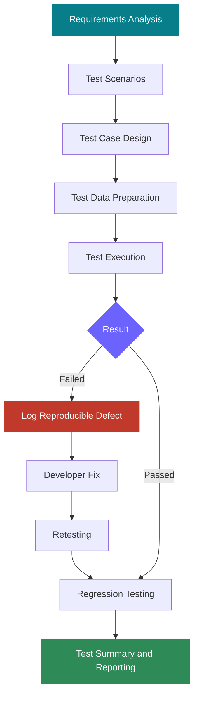

---

## 🧭 Quick Navigation

[About Me](#-about-me) · [Skills](#-toolbox) · [Projects](#-featured-qa-projects) · [Bug Reporting](#-how-i-report-bugs) · [Workflow](#-my-qa-workflow) · [Experience](#-professional-experience) · [Education](#-education--certification) · [Connect](#-lets-connect)

---

## 👋 About Me

I'm **Suraj Navgire**, a QA Engineer with **4 years of professional experience** in software testing, primarily across e-commerce web and Android applications. I enjoy investigating how products behave, uncovering edge cases, and turning unclear failures into actionable defect reports.

My experience spans web and mobile testing, SaaS products, API validation, SQL-based data checks, and testing an EV charging application with its web-based CMS. I am also building my UI automation practice with **Playwright and TypeScript**.

> 💡 **My QA mindset:** Don't just verify the happy path. Challenge assumptions, test boundaries, validate the data, and make defects easy to reproduce.

### At a glance

<table>
<tr>
<td align="center" width="25%">
 
<b>Test design</b> Portfolio-level figure
</td>
<td align="center" width="25%">
 
<b>Defect lifecycle</b> Portfolio-level figure
</td>
<td align="center" width="25%">
 
<b>Platforms</b> Web and mobile
</td>
<td align="center" width="25%">
 
<b>Automation</b> TypeScript
</td>
</tr>
</table>

*Counts above are portfolio-level figures; individual project metrics below describe separate engagements and should not be added together.*

---

## 🧰 Toolbox

### Testing

### Automation, API & data

### Tools & practices

**Testing coverage:** API validation · SQL data integrity · RBAC · Form validation · Negative testing · WebSocket behavior · E-commerce workflows · Defect triage · RTM · Test execution reporting

---

## 🚀 Featured QA Projects

### ⚡ 1. EV Charging Application & CMS

**Scope:** Mobile application + web-based Content Management System

Tested core application workflows and CMS functionality, with emphasis on permissions, data consistency, integrations, and real-time connector behavior.

- **777 functional test cases**
- **104 documented defect reports**
- **12 modules covered**
- Role-based access and permission validation
- Form validation, negative scenarios, and regression coverage
- API integration and WebSocket-based real-time behavior

**Tools:** Playwright, TypeScript, Postman, SQL, Git and GitHub.

---

### 🛍️ 2. Spiritual E-commerce Platform

**Scope:** Web + Android application

Testing coverage included e-commerce journeys and spiritual-service workflows across multiple user roles.

- **1,697+ test cases**
- **641+ documented defects**
- Product browsing, orders, and booking workflows
- Puja booking and astrologer consultation flows
- API validation, backend data checks, and regression testing
- Web and Android functional testing

**Tools:** Jira, Postman, SQL, browser and mobile testing tools.

---

### 🛒 3. E-commerce Web & Android Applications

Professional testing work covering functional quality, release validation, cross-browser behavior, and defect lifecycle management.

- Created and maintained **400+ test cases** across testing activities.
- Documented and tracked **200+ defects**.
- Tested web and Android workflows.
- Performed cross-browser checks across Chrome, Firefox, Safari, and Edge.
- Validated REST APIs using Postman and data using SQL.
- Worked with developers in Agile/Scrum workflows.

---

### 🔎 4. Web Application Validation & Defect Analysis

Focused testing assignments covering business rules, form validation, usability, integrations, and edge cases.

| Assignment | Coverage | Recorded outcome |
|---|---:|---|
| PR Form Testing | 70 test cases | 65 passed, 5 failed; 54 bugs documented |
| Homestay Booking Application | 90 test cases | 5 user roles covered |
| CRM–Accounting Connector | 18 test cases | 11 passed, 7 failed |
| AI Website & QMS Analysis | 18 test cases | 11 passed, 7 failed |
| E-commerce Admin & Frontend | Defect-focused | 10 bugs: 1 critical, 7 high |

*These are separate assignments, not one combined execution report.*

---

## 🐞 How I Report Bugs

A useful bug report makes an issue easy to reproduce and gives the team enough information to investigate it.

<b>🔴 Example: Missing validation for whitespace-only input</b>

**Title:** Mandatory title field accepts whitespace without a clear validation message.

**Precondition:** The user can access the form.

**Steps to reproduce**
1. Open the form.
2. Enter only spaces in the mandatory title field.
3. Fill any other required fields.
4. Submit the form.

**Expected result:** Whitespace-only input is rejected and a clear validation message is displayed.

**Actual result:** The application does not provide appropriate feedback for the invalid input.

**Testing focus:** Negative testing, input validation, and usability.

<b>📋 What my defect reports include</b>

- Bug ID and concise title
- Affected module
- Severity and priority
- Preconditions and test data
- Steps to reproduce
- Expected result
- Actual result
- Screenshots or supporting evidence
- Retesting status

---

## 🔄 My QA Workflow

### 🤖 Automation approach

I use Playwright and TypeScript for automation-related work, focusing on repeatable, high-value scenarios and maintainable tests.

- Browser automation and stable locators
- Authentication and form validation
- Positive and negative scenarios
- Reusable page objects where appropriate
- Regression execution and failure investigation
- Git-based version control

Manual exploratory testing remains important for uncovering unexpected behavior that scripted tests may not anticipate.

---

## 📂 Portfolio Documents

The repository contains supporting QA documents. Open the files directly from the repository:

- [Resume — QA_Suraj_Navgire_.pdf](./QA_Suraj_Navgire_.pdf)
- [AI Website QA Report](./Suraj_Navgire_Aivoa_AI_QA_Report.pdf)
- [CRM Connector QA Report](./Suraj_Navgire_Cloudify_QA_Report.pdf)
- [Homestay Booking QA Report](./Suraj_Navgire_HomestayBooking_QA_Report.pdf)
- [PR Form QA Report](./Suraj_Navgire_MorisMedia_QA_Report.pdf)
- [E-commerce Bug Report](./Suraj_Navgire_NovaCart_Bug_Report.pdf)

*If a document link does not open, check the exact filename in the repository because GitHub links must match file names and capitalization.*

---

## 💼 Professional Experience

### QA Engineer — E-commerce Web & Android Applications

**Sparkviz Technologies Pvt Ltd · Oct 2022 – Present**

- Execute functional, regression, smoke, sanity, and retesting cycles.
- Test web and Android application workflows.
- Perform cross-browser testing.
- Validate APIs with Postman and backend data with SQL.
- Create test documentation and track defects in Jira.
- Collaborate with developers and stakeholders in Agile/Scrum teams.

### Freelance QA Engagements

**Web Applications · SaaS · E-commerce · EV Charging CMS**

- Design and execute project-specific test cases.
- Investigate defects and document reproducible findings.
- Validate role-based permissions, integrations, and business rules.
- Test web and mobile application functionality.
- Prepare test case and defect report deliverables.
- Apply Playwright and TypeScript to automation-related work.

---

## 🎓 Education & Certification

<table>
<tr>
<td width="50%" valign="top">

### 🎓 Bachelor of Technology

**Dr. Babasaheb Ambedkar Technological University**

- Graduated: 2021
- CGPA: **8.05 / 10**

</td>
<td width="50%" valign="top">

### 🏅 ISTQB CTFL

**Certified Tester — Foundation Level**

- Certification year: 2026
- Focus: Software testing fundamentals and structured QA practices

</td>
</tr>
</table>

---

## 🌱 Professional Strengths

- Analytical thinking and attention to detail
- Structured test design and defect documentation
- Edge-case and negative testing
- Independent ownership of assigned testing tasks
- Clear communication with developers and stakeholders
- Business workflow understanding
- Continuous learning in test automation

---

## 🤝 Let's Connect

I'm interested in QA opportunities where I can contribute to product quality through manual testing, API validation, clear documentation, and UI automation.

  

**“Quality is not just about finding defects. It's about helping build better software.”**

